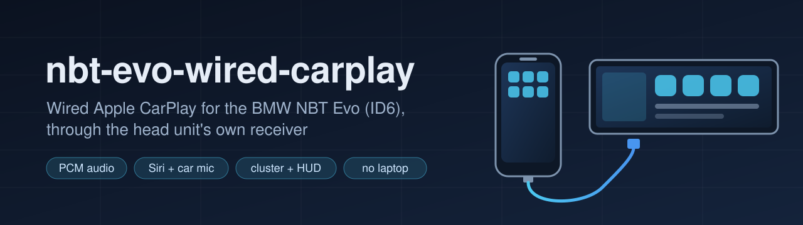
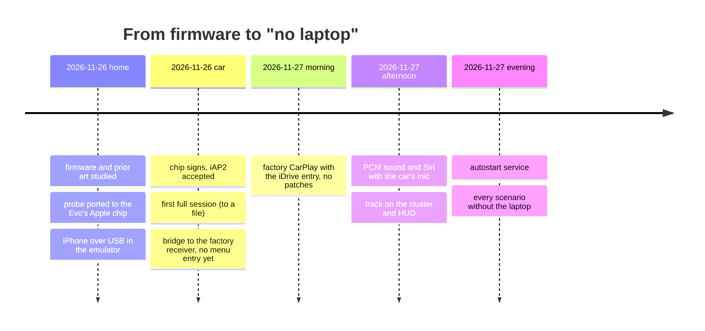
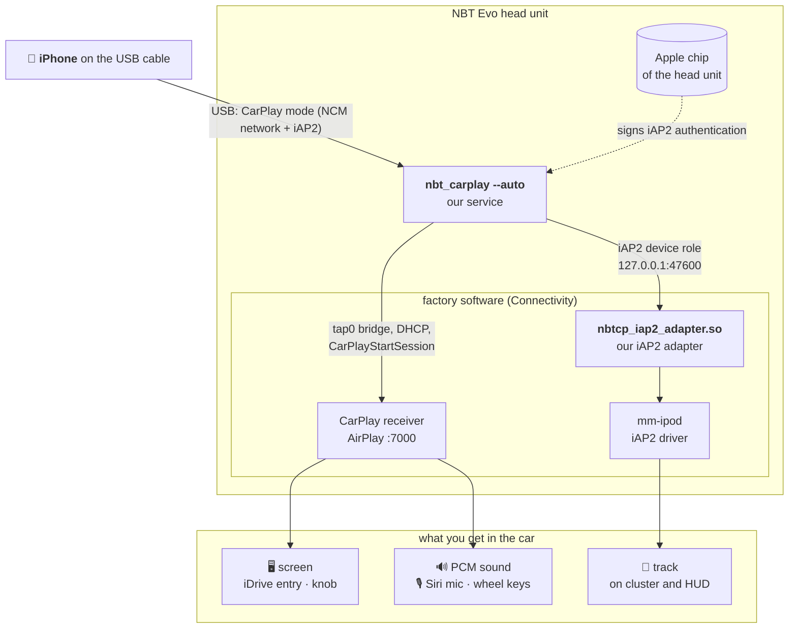
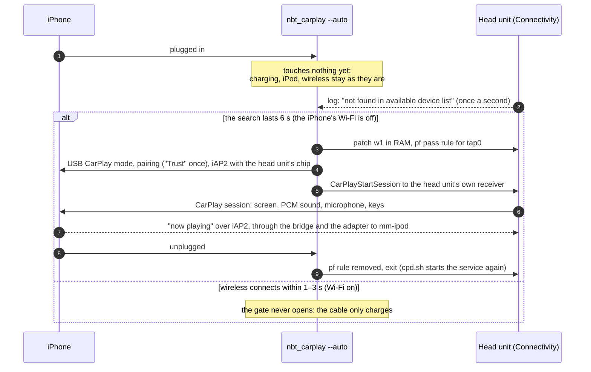

<p align="center">
  
</p>

<p align="center">
  <a href="LICENSE"></a>
  
  
  
  
</p>

<p align="center">
  <b>Plug the iPhone in with its cable, get the factory CarPlay: the iDrive entry, uncompressed sound, Siri with the
  car's microphone, the steering-wheel keys and the track on the cluster and HUD. Wireless CarPlay stays as it was.</b>
</p>

<p align="center">
  <a href="#installing-for-a-person">Install</a> ·
  <a href="#how-it-works">How it works</a> ·
  <a href="#rolling-back">Roll back</a> ·
  <a href="docs/README.md">Research notes</a> ·
  <a href="CONTRIBUTING.md">Contribute</a>
</p>

## At a glance

| | Over the cable | Notes |
|---|:---:|---|
| CarPlay on the head unit's screen, iDrive entry, iDrive controller | ✅ | the head unit's own receiver does it |
| Uncompressed sound (PCM 44.1/48 kHz) | ✅ | wireless stays AAC |
| Siri with the car's microphone | ✅ | PCM 24 kHz mono |
| Steering-wheel track keys | ✅ | |
| Track title and artist on the cluster and HUD | ✅ | needs patch `w1`; firmware-specific |
| Starts by itself, no laptop; "Trust" once | ✅ | iPhone Wi-Fi off = wired, on = wireless |
| Wireless CarPlay unchanged | ✅ | the service never touches a phone with Wi-Fi on |
| nbt-aa's navigation arrows on the HUD | ❌ | not forwarded over the cable yet |
| Other firmware than `NBTevo_N18032I`, other iPhones | ❓ | not tried yet: [send a car report](CONTRIBUTING.md#reporting-a-result-from-a-car) |

> [!WARNING]
> **Works on one car so far** (NBT Evo `NBTevo_N18032I`, iPhone15,2, iOS 27.2.1, 2026-11-27). It changes files on the
> head unit's flash and code in its memory; every change has a backup and an undo, but a mistake can make the head
> unit restart, and you need SSH access to recover. Read [Known limits](#known-limits) and
> [Rolling back](#rolling-back) first. You use it at your own risk.

<details>
<summary><b>Contents</b></summary>

- [Why](#why)
- [How it was done](#how-it-was-done)
- [How it works](#how-it-works)
- [What it changes on the head unit](#what-it-changes-on-the-head-unit)
- [Known limits](#known-limits)
- [Dependencies](#dependencies)
- [Installing: for a person](#installing-for-a-person)
- [Installing: for an agent](#installing-for-an-agent)
- [Rolling back](#rolling-back)
- [Tests](#tests)
- [Repository layout](#repository-layout)
- [Documents](#documents)
- [Contributing](#contributing)
- [License](#license)

</details>

## Why

The NBT Evo ID6 does CarPlay only wirelessly. On the USB port an iPhone only charges, or shows up as an iPod. Wireless
CarPlay works, but:

- the sound is compressed (AAC), and the head unit offers the phone nothing else;
- the phone needs Wi-Fi on, and wireless costs battery and adds lag;
- when the head unit's Wi-Fi or Bluetooth has a bad day, there is no other way in.

In November 2026 nobody offered open wired CarPlay for the Evo. One shop announced a closed, paid remote install.
An earlier attempt stopped at the USB role switch in the head unit's `vdev-medialaunch`. On the older NBT (x86),
Valentin Radu's `nbt_carplay` had just shown that an open wired CarPlay receiver is possible: USB, Apple's pairing,
iAP2 authentication with the head unit's own Apple chip, then AirPlay. The goal here was "as the factory would do it":
let the head unit's own receiver do the picture, sound, microphone, knob and menu, and only connect the cable to it.

## How it was done

Two days, from the firmware to a car that needs no laptop. The notes for each step are in [Documents](#documents).



<details>
<summary><b>The story, step by step</b></summary>

**2026-11-26, at home: firmware and emulator.** CarPlay-related files from six firmware builds (BMW PSdZData) were
studied, along with the prior art. Valentin Radu's probe was ported to the Evo's Apple authentication chip, which is
reached through a Harman `devctl` and a lock shared with the factory `acpd`. USB passthrough of a real iPhone into the
IDEmu emulator got the probe up to the point where the chip has to sign.

**2026-11-26, at the car.** The chip signed and the iPhone accepted iAP2 authentication. The full port of
`nbt_carplay` then ran a complete CarPlay session on the first try (H.264 1280×480, written to a file). Next came the
factory path. The bridge passes the iPhone's USB network (CDC NCM) to a `tap0` interface on the head unit, answers
the phone's DHCP, and asks the phone to start a session with the head unit's own AirPlay receiver. The factory
CarPlay screen came up, but iDrive had no menu entry for it. That evening a crash of our program left a core dump,
and **any core dump restarts this head unit**, so our programs now exit without one. Reverse engineering of the
head unit's `Connectivity` showed where the menu entry comes from: a state change ACTIVATION → ACTIVE, tied to the
phone's Bluetooth address.

**2026-11-27, morning, at the car.** No patches were needed for the menu entry. With the iPhone connected over
Bluetooth and its mode in iDrive set to "Apple CarPlay", the head unit looks for the phone for about a minute. A
session started inside that window gets the full factory treatment: the iDrive entry, CarPlay as the Media source,
the knob and the Siri button. The sound still stayed on the phone, and nothing reached the cluster.

**2026-11-27, at home and back at the car.**
- **Sound:** the receiver offers the phone only the formats in `carplay.ini`, which lists AAC only (the wireless
  set). Adding 16-bit PCM lines, the formats wired CarPlay uses, fixed it: PCM music at 44.1 or 48 kHz, Siri with
  the car's microphone (PCM 24 kHz mono), and the steering-wheel track keys.
- **Cluster and HUD:** the factory gets "now playing" over iAP2 inside the wireless session (`mm-ipod`). Over the
  cable, the iPhone's iAP2 ends in our bridge. A small library sits in `carplay.ini`'s `[iAP2] LibPath`, in front of
  the adapter that was there before, and passes everything through. Our bridge then plays the iPhone towards the
  factory `mm-ipod`. A 4-byte patch in RAM (`w1`) lets the CarPlay module start `mm-ipod` for a wired session
  (normally it does so for Wi-Fi only). Track names showed on the cluster and the HUD.

**2026-11-27, evening, at the car.** The autostart service went in. The adapter starts a small shell loop once at
boot. The loop runs `nbt_carplay --auto`, which waits for an iPhone on USB and reads the head unit's log. It takes
the iPhone only when the head unit has been searching for it for 6 seconds. That happens only when the phone's
Wi-Fi is off; with Wi-Fi on, wireless connects within 1–3 s and the service leaves the phone alone. Every scenario
on the checklist passed without the laptop: Trust once, wireless unchanged, plugging and unplugging, and a head-unit
restart with the cable in.

Things learned the hard way are listed in [CONTRIBUTING.md](CONTRIBUTING.md#head-unit-facts-you-must-know).

</details>

## How it works

Our service only connects the cable to the head unit's **own** CarPlay receiver. The receiver does the picture, the
sound, the microphone, the knob, the steering-wheel keys and the iDrive entry, exactly as it does for wireless CarPlay.



When the service takes the iPhone, and when it leaves it alone:



<details>
<summary><b>The same, step by step (text)</b></summary>

```
iPhone ──USB──┬─ factory iPod handlers (vdev-medialaunch, io-fs-media -dipod …): ended for the session, respawned after
              │
              └─ nbt_carplay --auto            (our service: /var/opt/nbt-cp, started by cpd.sh)
                   1. waits for an iPhone on USB, touching nothing (charging, iPod, wireless all stay as they are)
                   2. reads the head unit's log; takes the iPhone only after ≥ 6 s of "looking for the phone"
                   3. USB vendor request 0x52 → the iPhone's CarPlay configuration (CDC NCM + iAP2)
                   4. lockdown pairing ("Trust" once; the record stays in /var/opt/nbt-cp/state)
                   5. iAP2 with the iPhone: identification, authentication with the head unit's Apple chip
                   6. NCM ⇄ tap0 bridge, DHCP answer 172.16.226.100, pf pass rule for tap0 (RAM)
                   7. CarPlayStartSession → the head unit's own AirPlay receiver on 172.16.226.1:7000
                   8. iAP2 "device role" ⇄ 127.0.0.1:47600 ⇄ nbtcp_iap2_adapter.so (inside Connectivity)
                                                         ⇄ previous adapter ⇄ /dev/carplayiap ⇄ mm-ipod → cluster, HUD
                   9. iPhone unplugged or session over → pf rule removed, exit; cpd.sh starts the next one

factory receiver (Connectivity + libconn_carplay): picture, PCM sound, microphone, knob, steering-wheel keys, iDrive entry
```

</details>

| Piece | Folder | Runs | What it does |
|---|---|---|---|
| `nbt_carplay` | [`nbt-carplay-evo/`](nbt-carplay-evo/) | own process | USB, pairing, iAP2, NCM bridge, session start, `--auto` service logic. Port of Valentin Radu's `nbt_carplay` |
| `nbtcp_iap2_adapter.so` | [`iap2-adapter/`](iap2-adapter/) | inside `Connectivity` | passes the factory iAP2 adapter through; hands `mm-ipod` to the bridge during a wired session; starts the service at boot |
| `conn_patch` | [`conn-patch/`](conn-patch/) | short-lived | writes/reverts the `w1` patch in the running `Connectivity`'s RAM, only if the whole function matches |
| `cpd.sh` | [`car/autostart/`](car/autostart/) | own process | restart loop for the service, with crash limits |
| `car-chip-test.sh` | [`car/`](car/) | on the laptop | every install, check, test and rollback step, as named stages over SSH |

<details>
<summary><b>Changes against upstream <code>nbt_carplay</code>, by file</b></summary>

Upstream: JayJay3071/nbt-android-auto `src/carplay` at 78b098e.
`cp_acp.c` (the Evo's chip: node, Harman `devctl`, shared lock with `acpd`),
`cp_ncm.c` (bridge to `tap0`, DHCP, reading the receiver's mDNS, controller announcement),
`nbt_carplay.c` (options `--bridge`, `--bridge-start`, `--bridge-ctrl`, `--auto`, `--iap2-factory`; fatal signals
end the program without a core dump; the `--state` folder defaults to RAM, and the service passes
`/var/opt/nbt-cp/state`),
`cp_iap2.c` (session start with the head unit's own receiver, which announces no key; hand-off to the device role)
and new `cp_iap2dev.c` (device role towards `mm-ipod`), new `cp_auto.c` (the service's gate and `w1` decision),
new `cp_ctrl.c` (controller server), `cp_usb.c` (with `--auto`, the iPhone is not touched until the gate opens),
`cp_audio.c` (`liba2i_client.so` from `/opt/mm/lib`), and `/fs/ram3` → `CP_RAM` in `cp_airplay.c`,
`cp_lockdown.c` and `cp_mic.c`.

</details>

## What it changes on the head unit

| Change | Where | Kept on | Undo |
|---|---|---|---|
| 29 PCM lines added to `[Audio]` (AAC lines kept) | `/var/opt/conn/carplay/carplay.ini` | flash; backup `carplay.ini.before-pcm` | `pcm-revert` + restart |
| `[iAP2] LibPath` → our adapter (it loads the previous one) | same file | flash; backup `carplay.ini.before-iap2` | `iap2-uninstall` + restart |
| programs, service, pairing record, autostart flag | `/var/opt/nbt-cp/` | flash | `auto-off`, `auto-uninstall` (`PURGE=1` also removes the pairing) |
| adapter's start counter (boot-loop guard) | `/var/opt/nbt-cp/starts` | flash, 2 small writes per boot | goes with the adapter |
| `w1`: 4 bytes in `libconn_carplay.so`'s code page | `Connectivity`'s memory | RAM, per session | `conn-revert w1` or any restart |
| pf pass rule for `tap0` | anchor `filter_USB` | RAM, during a session | removed at session end |
| logs | `/dev/shmem/nbt-carplay.log`, `/dev/shmem/nbtcp-iap2.log` | RAM | restart |

Nothing else is written. The firmware files on the system partition are not touched.

Safety nets that work without a laptop:
- the adapter hands the CarPlay module the previous adapter directly (as if never installed) after two starts in a
  row that did not last 2 minutes, or when `/var/opt/nbt-cp/disable` exists;
- `cpd.sh` stops after 5 crashes in a row and slows to one run a minute after 10 short runs;
- if a wired session with iAP2 ends within 15 s, `w1` stays off until the next restart: CarPlay without track names
  beats a loop of dropouts;
- `conn_patch` refuses if any byte of the function around the patch differs, for example after a firmware update.
  You then get CarPlay without track names.

## Known limits

- **One car so far:** `NBTevo_N18032I`, one iPhone (iPhone15,2, iOS 27.2.1). Other firmware may lose the track
  names (see [Dependencies](#dependencies)).
- **The head unit looks for the phone for about a minute after it starts.** If you plug the cable in later, choose
  iDrive → Mobile devices → iPhone → "Apple CarPlay", or press "Retry" in the error window.
- **The first "Trust"** can take longer than that minute while you answer on the iPhone; then press "Retry".
- **One pairing record:** a second iPhone overwrites it with its own "Trust".
- **Not forwarded over the cable yet:** nbt-aa's navigation arrows on the HUD, cover art, call control from the car,
  the car's GPS to the iPhone.
- **With the iPhone's Wi-Fi off**, the iPhone shows "Turn On Wi-Fi to Use Wireless CarPlay" while the head unit
  first tries wireless.
- **Not yet run on a car:** the bridge built from a clean clone (`57e9f8a0…`, see [Dependencies](#dependencies)) and
  the stage `conn-pull`.

## Dependencies

**Head unit**
- BMW NBT Evo ID6 with factory (wireless) CarPlay enabled and working with your iPhone. Only `NBTevo_N18032I` has
  been tested. On other firmware, `conn-patch/build.sh` leaves out each patch whose function differs:
  - if `w1` is left out, the service runs CarPlay without track names on the cluster (it logs
    "w1 could not be applied");
  - if every patch is left out, `conn_patch` is not built, and `auto-install` refuses. That case needs work first.
- Root SSH to the head unit over the ENET cable (OBD port; link-local address, the scripts default to
  `169.254.199.119`, set `HU=root@<address>` for yours). You need the root password.
- The iPhone paired over Bluetooth with the head unit, and its mode in iDrive (Mobile devices) set to "Apple CarPlay".
- Tested with the nbt-aa project's CarPlay adapter in `LibPath` (ours chains to whatever is there). With the plain
  factory adapter it has been checked in the emulator only.

**iPhone:** iPhone15,2 with iOS 27.2.1 tested; any iPhone that does wired CarPlay should work.

**Build machine** (macOS tested; Linux should work):
- Docker. On Apple silicon it runs the amd64 image under emulation.
- The Docker image `qnx65-armv7-toolchain:4.9` (GCC 4.9 for QNX 6.5 ARMv7), built from
  [luka-dev/qnx65-armv7-toolchain](https://github.com/luka-dev/qnx65-armv7-toolchain) with
  `./host-scripts/qnx-run.sh build 4.9` (needs network, about 30 minutes, ~1 GB).
- `git`, `curl`, `python3`, `ssh`, and `clang` (Xcode command line tools) for the host tests.
- Fetched by `scripts/fetch-deps.sh` at pinned commits: upstream
  [nbt-android-auto](https://github.com/JayJay3071/nbt-android-auto) `78b098e` (its Mbed TLS patch scripts),
  lwIP 2.2.1 (`77dcd25a`), Monocypher 4.0.2 (`0d85f98c`). Mbed TLS 3.6.7 is downloaded by `probe-evo/build.sh`
  (SHA-256 checked).
- For `conn_patch`: copies of your head unit's `Connectivity` and `libconn_carplay.so`, pulled by the read-only stage
  `car/car-chip-test.sh conn-pull`. They are head-unit code, so they stay on your machine and are never committed.
  That stage is new and **has not run on a car yet**. It reads the files the running program was started from
  (`/opt/conn/bin/Connectivity`, as the head unit's log shows). The tested car's table came from copies of those
  same files.

**Optional:** [IDEmu](https://github.com/herrbimmer/IDEmu) with the USB patch in [`emu-usb/idemu/`](emu-usb/idemu/)
and your own firmware image, for tests without the car; `capstone` for `tools/annot.py`.

**Reproducible builds.** A clean clone (checked 2026-11-27) gives these files. The right-hand column shows what runs
on the tested car:

| File | From a clean clone | On the tested car |
|---|---|---|
| `iap2-adapter/out/nbtcp_iap2_adapter.so` | `66f2037144c50ab28d60e83b497928ade643f9bb119d663fec6b0bb5bc5b537c` | the same |
| `conn-patch/out/conn_patch` (table from `NBTevo_N18032I`) | `049887d8b90f26c6d5bf505a04462d35cd4b5399eb5efdd905aeac85dfb0e733` | the same |
| `car/autostart/cpd.sh` | `4eeb9890846b506662392a04042ce8e5af2b53acce4825c0b6d3dd672cd0fb9f` | the same |
| `nbt-carplay-evo/out/nbt_carplay.stripped` | `57e9f8a02ab92a28be3f80d517af6081b656670b7cfe4aeb548e25ae8f182119` | `32ec4c0925ab375c86fd9d1935dafc6e7a9b65bb95957b636a662668e4be2f8b` |

The car's `nbt_carplay` differs only in the Mbed TLS objects. They come from a library build of 2026-11-26 whose
exact compiler flags were not recorded, from the same sources and the same compiler. Linked against that library, the
bridge from this repository is bit-for-bit the car's build. **The clean-clone bridge `57e9f8a0…` has not yet run on a
car.**

## Installing: for a person

Plan about 1.5 hours at the car, with three head-unit restarts. Steps that write to the head unit's flash are marked
**FLASH**. Each of them makes a backup first and has its own undo. The car script prints what it did; its logs go to
`car/runs/<date-time>/`. Those logs hold your iPhone's name and the chip's certificate, so keep them private. The
detailed checklists are [car/CHECKLIST-next-visit.md](car/CHECKLIST-next-visit.md) (sound and iAP2) and
[car/CHECKLIST-autostart.md](car/CHECKLIST-autostart.md) (the service).

**1. At home: build and test.**
```bash
git clone https://github.com/bw0711/nbt-evo-wired-carplay.git && cd nbt-evo-wired-carplay
./scripts/fetch-deps.sh
./scripts/test-host.sh        # "all 5 host tests passed"
./scripts/build-all.sh        # conn-patch is skipped until step 2; the rest prints its SHA-256
```

**2. At the car: connect and read.** Plug the ENET cable into the OBD port, switch the ignition on, and wait for the
head unit to boot. Open one SSH connection yourself and type the password. The scripts reuse it for 5 minutes, so
open it again after each head-unit restart. On macOS, link-local traffic goes out over Wi-Fi unless you bind the
cable's interface (find it with `ifconfig`; here it was `en7`):
```bash
ssh -B en7 root@169.254.199.119 true
car/car-chip-test.sh check       # read-only overview
car/car-chip-test.sh conn-pull   # read-only: copies Connectivity + libconn_carplay.so to this laptop
conn-patch/build.sh              # "patch table from …"; a "left out" warning means other firmware: no track names
```

**3. Uncompressed sound (FLASH).**
```bash
car/car-chip-test.sh pcm-check   # "… 0 of them PCM; backup on the head unit: no"
car/car-chip-test.sh pcm-apply   # "29 PCM lines added", "written, SHA-256 …"
```
Wait 30 seconds, then restart the head unit: hold the volume knob for about 30 seconds until the screen goes dark,
or switch the ignition off, let the unit go to sleep, and switch it on again. Open SSH again, then run `pcm-check`;
it should now show 29 PCM lines. Check that wireless CarPlay still works as before.

**4. Track names on the cluster (FLASH).**
```bash
car/car-chip-test.sh iap2-check
car/car-chip-test.sh iap2-install   # "chaining to …", "installed"
```
Restart the head unit and open SSH again. Run `iap2-check`: the adapter log shows "initialized", and after 2 minutes
"start count cleared". Check wireless CarPlay again: sound, track name and steering-wheel keys.

**5. The service (FLASH).**
```bash
car/car-chip-test.sh auto-install   # "installed (no autostart flag yet)"
car/car-chip-test.sh auto-try       # one run by hand
```
For the `auto-try` run, set things up like this: the iPhone's Wi-Fi off **in Settings** (the Control Center toggle
is not enough), the iPhone's mode "Apple CarPlay" in iDrive, and the cable in. Answer "Trust" on the iPhone. CarPlay
comes up in 10–30 s. Unplug, then run `auto-try` again: this time there is no Trust question. Then:
```bash
car/car-chip-test.sh auto-on        # "autostart: on"
```
Restart the head unit. After it boots, run `auto-check`. The adapter log says "wired CarPlay service started" and the
service log says "cpd: started".

**Everyday use, no laptop.**
- **Wired:** switch the iPhone's Wi-Fi off in Settings and plug the cable in. CarPlay comes up in 10–30 s.
- **Wireless:** leave Wi-Fi on. The cable then only charges.
- After a head-unit start, the unit looks for the phone for about a minute. If you plug the cable in later, choose
  iDrive → Mobile devices → iPhone → "Apple CarPlay", or press "Retry" in the error window.

## Installing: for an agent

Follow the person's steps above, with these rules. The rules come first, and a step is never worth breaking one.

<details>
<summary><b>Rules and the step-by-step sequence for AI agents</b></summary>

**Rules**
1. **FLASH stages need the owner's explicit "yes" for that stage, given at that moment.** A yes for one stage does
   not cover the next. The FLASH stages are `pcm-apply`, `pcm-revert`, `iap2-install`, `iap2-uninstall`,
   `auto-install`, `auto-on`, `auto-off` and `auto-uninstall`. The RAM stages also touch a live head unit, so say
   what you are about to run before running them: `conn-apply`, `conn-revert`, `bridge*`, `auto-try`, `push`,
   `session` and `cleanup`. The read-only stages need no yes: `check`, `conn-pull`, `conn-check`, `pcm-check`,
   `iap2-check`, `auto-check`, `pf-check`, `trace` and `nbt-aa-pull`.
2. **Never type or store the head unit's password.** The owner opens the SSH connection. The scripts use `BatchMode`
   and stop if no connection is open: ask the owner to run `ssh -B <interface> root@<address> true` again.
3. **Read-only first.** Before any write, run the matching `*-check` stage and compare its output with the expected
   text below. If anything differs, stop, show the output, and ask.
4. **Stop on anything unexpected.** That includes a stage that prints "MISMATCH", "nothing written", "refuses" or
   "left out", or an error. Do not retry a write with `FORCE=1` or by hand. Report what happened and propose the
   matching undo from [Rolling back](#rolling-back).
5. Never run a full `pidin fds` on this head unit: it hangs until the next restart. The head unit has no `awk`, `tr`,
   `head`, `netstat` or `tcpdump`.
6. A core dump of **any** program restarts this head unit. Never run a build of ours without its no-core signal
   handling. Never put pcaps or big files in the head unit's `/tmp`: it is a 14 MB RAM disk, and filling it broke
   Siri once.
7. Never edit `car/car-chip-test.sh` while one of its stages is running.
8. Never commit or paste anything from `car/runs/`, files pulled from the head unit, pairing records, the chip's
   certificate, Bluetooth addresses, UDIDs or VINs. Redact them in reports.
9. Changes to code go through `scripts/test-host.sh` first. Where the change touches QNX behaviour, test it in IDEmu
   (`emu-usb/README.md`) before the car. See [CONTRIBUTING.md](CONTRIBUTING.md).

**Sequence, with the text that must appear before going on**

| # | Command (from the repository root) | Kind | Go on only if the output has |
|---|---|---|---|
| A1 | `./scripts/fetch-deps.sh` | local | `ok` / `got` for all three |
| A2 | `docker image inspect qnx65-armv7-toolchain:4.9` | local | an image; if missing, ask before building it (~30 min) |
| A3 | `./scripts/test-host.sh` | local | `all 5 host tests passed` |
| A4 | `./scripts/build-all.sh` | local | SHA-256 values; compare with the table above and report any difference |
| B1 | owner: `ssh -B <if> root@<address> true` | owner | the owner says it is open |
| B2 | `car/car-chip-test.sh check` | read | a new `runs/` folder; processes listed |
| B3 | `car/car-chip-test.sh conn-pull` then `conn-patch/build.sh` | read, local | `patch table from`; any `left out` → tell the owner track names will not work |
| B4 | `car/car-chip-test.sh pcm-check` | read | `0 of them PCM; backup on the head unit: no` |
| B5 | `car/car-chip-test.sh pcm-apply` (ask) | FLASH | `PCM lines added`, `written, SHA-256` |
| B6 | owner restarts the head unit and reopens SSH; `pcm-check` | read | `29 of them PCM` |
| B7 | `car/car-chip-test.sh iap2-check`, then `iap2-install` (ask) | FLASH | `chaining to`, `installed` |
| B8 | owner restarts, reopens SSH; `iap2-check` | read | `initialized` (later `start count cleared`) |
| B9 | `car/car-chip-test.sh auto-install` (ask) | FLASH | `installed (no autostart flag yet)` |
| B10 | `car/car-chip-test.sh auto-try`; owner: Wi-Fi off in Settings, cable in, Trust | RAM | `auto: taking the iPhone over`; CarPlay on screen (ask the owner) |
| B11 | `car/car-chip-test.sh auto-on` (ask) | FLASH | `autostart: on` |
| B12 | owner restarts, reopens SSH; `auto-check` | read | `wired CarPlay service started`, `cpd: started` |

At the end, give the owner the run folder `car/runs/<date-time>/` (it is private) and one line per step.

</details>

## Rolling back

Undo in the reverse order of installing, then restart the head unit:
```bash
car/car-chip-test.sh conn-revert w1      # only if a session is running with w1; a restart also clears it
car/car-chip-test.sh auto-off            # FLASH: removes the flag, stops the service, puts w1 back
car/car-chip-test.sh auto-uninstall      # FLASH: removes the programs (PURGE=1 also the pairing record)
car/car-chip-test.sh iap2-uninstall      # FLASH: the LibPath line as it was
car/car-chip-test.sh pcm-revert          # FLASH: carplay.ini from the backup taken before PCM
```
`pcm-revert` refuses while our adapter is still in `LibPath`; run `iap2-uninstall` first. To switch the adapter off
without undoing anything, run `touch /var/opt/nbt-cp/disable` over SSH and restart: the CarPlay module then gets the
previous adapter directly.

## Tests

- **Host** (Mac/Linux, ASan + UBSan, no hardware): `./scripts/test-host.sh` covers the service's gate, the iAP2 device
  role against a fake `mm-ipod`, the whole `--bridge-start --iap2-factory` flow with both ends faked, the controller
  server, and the adapter (chaining, hand-over, boot-loop guard, service start). `nbt-carplay-evo/test-host/bridge_replay.c`
  replays your own car recordings (pcap) and 200,000 mangled frames through the bridge.
- **IDEmu** (QNX 6.5 guest, real iPhone over USB passthrough): [`emu-usb/README.md`](emu-usb/README.md). It covers USB,
  pairing, carkit and iAP2 identification. The emulator has no Apple chip. The iAP2 chain with the real `mm-ipod` and
  a fake chip is in [`iap2-adapter/README.md`](iap2-adapter/README.md) and `iap2-adapter/bench/`.
- **Car:** the stages of [`car/car-chip-test.sh`](car/car-chip-test.sh) (run it without arguments for the list).
  The results of each visit are in `car/RESULT-*.md`.

## Repository layout

| Path | What |
|---|---|
| [`nbt-carplay-evo/`](nbt-carplay-evo/) | the bridge/service (`nbt_carplay`), its build and host tests |
| [`iap2-adapter/`](iap2-adapter/) | the iAP2 adapter library, its host test and the IDEmu bench |
| [`conn-patch/`](conn-patch/) | `conn_patch` and `gen_tab.py` (patch table from your own head unit) |
| [`car/`](car/) | `car-chip-test.sh` (all stages), `make_pcm_ini.py`, `make_iap2_ini.py`, checklists, results |
| [`car/autostart/`](car/autostart/) | `cpd.sh` and how the service works |
| [`probe-evo/`](probe-evo/) | the first step: Valentin Radu's probe ported to the Evo; its build also makes Mbed TLS |
| [`emu-usb/`](emu-usb/) | iPhone over USB in IDEmu: guest helpers, and the IDEmu patch in `idemu/` |
| [`scripts/`](scripts/) | `fetch-deps.sh`, `build-all.sh`, `test-host.sh` |
| [`tools/`](tools/) | reverse-engineering helpers (`annot.py`, `xref.py`, `dis.sh`, `swfl_pick.py`) |
| [`docs/`](docs/) | [index](docs/README.md), [`research/`](docs/research/) notes, the banner in `assets/` |

## Documents

The full index with dates is [docs/README.md](docs/README.md). The most useful ones:

- [Where the iDrive entry comes from](docs/research/factory-like-device-list-re-2026-11-26.md): DipoState and the
  Bluetooth address, patches c1/c2.
- [Why the sound stayed on the phone](docs/research/audio-pcm-re-2026-11-27.md), and the PCM lines that fix it.
- [How "now playing" reaches the cluster](docs/research/iap2-factory-re-2026-11-27.md), and why the adapter and `w1`.
- [Who tried what before](docs/research/prior-art-2026-11-26.md).
- What happened at each car visit: [26.11](car/RESULT-2026-11-26.md), [27.11 morning](car/RESULT-2026-11-27.md),
  [27.11 afternoon](car/RESULT-2026-11-27-pm.md), [27.11 evening](car/RESULT-2026-11-27-evening.md).

## Contributing

Read [CONTRIBUTING.md](CONTRIBUTING.md). In short: test on the host and in the emulator before a car, never commit
anything pulled from a head unit or anything that identifies a person or a car, keep every head-unit change
reversible and failing closed, and sign off your commits.

## License

GPL-3.0-only (see [LICENSE](LICENSE) and [NOTICE.md](NOTICE.md)). `nbt-carplay-evo/` and `probe-evo/` are modified
versions of Valentin Radu's `nbt_carplay`, as published in JayJay3071/nbt-android-auto. Their notices are kept in
each folder.

This project is not affiliated with or endorsed by BMW AG, Harman or Apple Inc. BMW and iDrive are trademarks of
BMW AG; Apple, iPhone and CarPlay are trademarks of Apple Inc. No software of BMW, Harman, Apple or QNX is included.
The programs use what is already on the head unit and the iPhone.
